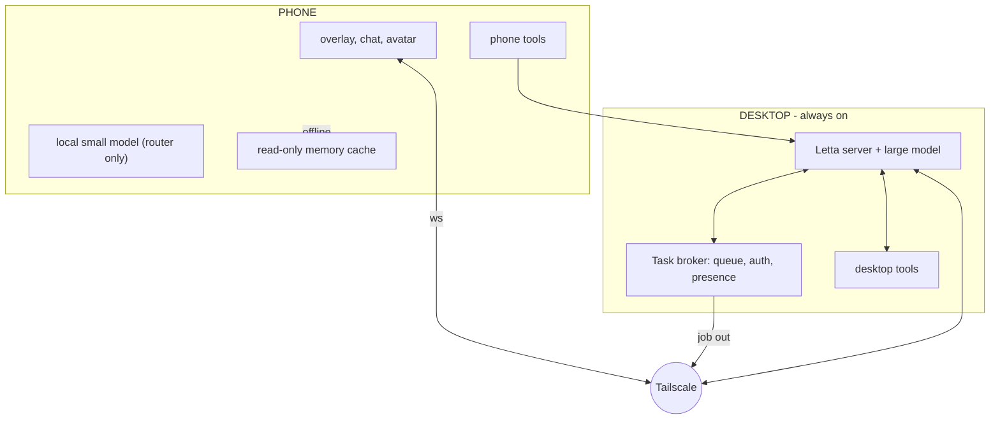

# MalO v2 — Feature Plan

Status: draft for review
Owner: chugs
Target: parity of capability between desktop and Android, single shared identity

---

## 1. Purpose

MalO is currently a desktop agent that works. This document plans the move to two
bodies with one identity: the same agent, reachable from a phone, with the phone
carrying real capabilities and a real local model, and with the desktop absorbing
work the phone cannot do.

The goal is not two apps. It is one agent with two controllers, where "which device
am I on" changes what she can do, not who she is.

## 2. Non-goals

- Multi-user. One human, one agent.
- Cloud hosting. Local + Tailscale only.
- NSFW mechanics. Modelled on SCP-1471 and MalOvent, without the adult content.
- Apocalypse / end-of-world narrative beats.
- Device Owner provisioning in v2 (see §14.3).
- iOS.

## 3. Architecture contract

Four rules. Violating any of them is what turns this into a six-month swamp.

1. **One agent ID.** Both controllers attach to the same agent and conversation.
   Never a second agent, never a merge.
2. **Namespaced tools.** `phone_*` registered only while a phone is attached;
   `desk_*` / `screen_*` only on the desktop. A controller advertises its tier.
3. **Presence.** The agent knows which controller is active and what tier it has.
   Phone-only tools are not offered when no phone is attached.
4. **Single writer when reachable.** The phone caches memory blocks read-only.
   Local writes are sequence-stamped and replayed on reconnect. The agent arbitrates.



## 4. Milestones

| ID | Milestone | Depends on | Exit criterion |
|---|---|---|---|
| M1 | Task broker | — | Phone can enqueue a job; desktop completes it; phone gets a result |
| M2 | Desktop manifest + check-in | — | She appears over the desktop unprompted and can be dismissed for an hour |
| M3 | Phone tier 0–2, overlay | M1 | Battery, notifications and usage readable; avatar over an app |
| M4 | Offline cache + replay | M3 | Airplane mode for 10 min, reconnect, no lost writes |
| M5 | Idle interest research | M3 | Three consecutive days of non-spammy pings |
| M6 | Self learning + pruning | M4 | Memory block stays under budget for a week |
| M7 | Phone model as router | M1, M3 | 90% of turns routed correctly without a human |
| M8 | Mic context pings | M7 | One useful ping per hour of conversation, one annoyance per day |
| M9 | Self modification | M6 | Three applied self-edits without a manual revert |
| M10 | Phone system optimisation | M3 | Shizuku path force-stops a drainer on request |

M1 and M2 have no dependency on each other or on the phone and can start now.

---

## 5. M1 — Task broker

### Goal
The phone can hand work to the desktop and get told when it is done, without the
phone needing a large model.

### Why first
Everything expensive on the phone (agentic work, long jobs, big context) becomes
cheap once this exists. It also lets the phone stay a thin controller, which is
what keeps the phone model requirement at router level instead of agent level.

### Approaches

**A. Queue table + long-poll.** SQLite table `jobs(id, goal, tier, status, result,
created, claimed, done)`. Desktop polls every 2s. Result pushed back over the
existing phone WS.
- Cost: ~2 days. No new dependencies. Survives restarts.
- Risk: polling latency, no backpressure.

**B. WS job channel with server push.** Broker holds both ends open, dispatches on
enqueue.
- Cost: ~1 week. Sub-second.
- Risk: reconnection logic on both sides, more state to get wrong.

**C. Message broker (Redis / MQTT / NATS).**
- Cost: 1–2 weeks plus a daemon to keep alive.
- Risk: another thing to run on Windows. Overkill for one user.

**Recommendation: A.** Latency of 2s is invisible for jobs that take minutes.

### Design notes
- `tier` is `small | large`. `small` runs on the phone, `large` on the desktop.
- Every job carries the originating conversation ID so the result lands in context.
- Jobs expire after 24h; expired jobs are reported as failed, not dropped.
- Auth: bearer token per device, issued at pairing, checked on every broker call.
- The desktop must be able to refuse: `busy`, `no model`, `quota`.
- Result delivery is a notification plus a message into the conversation. Never
  silent — a job that completes with nobody told is worse than no job.

### Acceptance criteria
- Enqueue from phone with the desktop asleep → desktop boots → job runs → phone notified.
- Kill the desktop mid-job → job returns to `queued`, not stuck.
- Enqueue 20 jobs → they run in order, none lost.
- A job with a bad token is rejected.

### Risks
- **PC asleep is the default state.** Needs Wake-on-LAN or an always-on policy.
  Decide in §14.1.
- Long jobs vs phone sleep: the phone must not depend on being awake to receive.

---

## 6. M2 — Desktop manifest and check-in

### Goal
She occupies a corner of the display as a body, not a window, and occasionally
speaks first.

### Why
This is the cheapest large change in felt quality, and it exercises the overlay and
idle behaviour that the phone will reuse.

### Approaches

**A. Always-on-top borderless Tk toplevel.** `overrideredirect(True)`,
`-topmost`, transparent colour key, click-through regions.
- Cost: ~3 days. Reuses the existing avatar rig.
- Risk: Tk transparency is colour-key only, so edges alias. No per-pixel alpha.

**B. Separate overlay process with a proper compositor surface** (Win32 layered
window, per-pixel alpha).
- Cost: 1–2 weeks. Clean edges, real alpha.
- Risk: new Win32 surface, DPI handling, another process.

**C. Just keep her in the app window.** No work, no payoff.

**Recommendation: A for v2, B if the aliasing bothers you.** Ship the behaviour
before the pixels.

### Behaviour design
- Idle animation loop, 12fps, pauses when she's behind a fullscreen app.
- Unprompted lines are rate-limited: at most one per 20 min, none within 10 min of
  the last user message.
- Every line has a dismiss: right-click → quiet for 1h.
- She never covers the centre of the screen; corners only, and she yields if the
  window under her is fullscreen.

### Acceptance criteria
- Runs 8h without leaking handles or eating >2% CPU.
- Hidden automatically during fullscreen video.
- Three unprompted lines in a day, none rated annoying.

---

## 7. M3 — Phone tiers 0–2 and overlay

### Goal
The phone reports its own state, reads notifications and app usage, and hosts her
overlay.

### Tier definitions

| Tier | Capability | Permission |
|---|---|---|
| 0 | battery, charge, storage, thermal, network, model | none |
| 1 | read, post, dismiss notifications | NotificationListenerService |
| 2 | app usage, foreground app, screen time | UsageStats |

Tier 3 (overlay) and 4 (accessibility) are separate grants, requested in character,
not from a settings wall.

### Approaches for the overlay

**A. `TYPE_APPLICATION_OVERLAY` + `TextureView`, frame sequence.**
`FLAG_NOT_FOCUSABLE | FLAG_NOT_TOUCH_MODAL`, `FLAG_NOT_TOUCHABLE` on the body.
- Cost: 1 week. Cheapest, most compatible.
- Risk: occlusion; hidden by some fullscreen apps; banking apps refuse.

**B. Same, plus `FLAG_LAYOUT_NO_LIMITS` and per-pixel alpha.**
- Cost: 1.5 weeks. Better edges.
- Risk: more device-specific breakage.

**C. Foreground-service-driven `SurfaceControl` layer.**
- Cost: 3 weeks. Best fidelity, most brittle.

**Recommendation: A.** Dockable corner, small, toggle in the shade.

### Design notes
- Overlay auto-hides on fullscreen immersive and returns on exit.
- Touch passthrough on the body; only the dismiss chip is touchable.
- Never render above the keyboard.
- A persistent "she's visible" notification with a hide action.

### Acceptance criteria
- Overlay survives 2h of app switching.
- Taps in the overlay region reach the app underneath.
- Hides within 200ms of entering fullscreen.

---

## 8. M4 — Offline cache and replay

### Goal
Losing the network does not lose her memory or her work.

### Approaches

**A. Read-only cache + sequence-stamped replay.**
Phone holds a snapshot of memory blocks. Offline, the phone model answers from the
snapshot. Writes are queued with a monotonic `seq`. On reconnect the queue replays
and the agent arbitrates conflicts.
- Cost: 1 week. No merge problem, because only the agent writes.
- Risk: stale snapshot; agent may have changed blocks meanwhile.

**B. Two agents, bidirectional merge.**
- Cost: 4–6 weeks. True offline capability.
- Risk: permanent conflict-resolution burden, divergence, duplicated memory.

**Recommendation: A.** B is a different project.

### Design notes
- Snapshot refresh on every connect and every 15 min while connected.
- Stale-write rule: if the agent's block `updated_at` is newer than the snapshot,
  replay as a *proposal* ("while offline she noted X") rather than an overwrite.
- Cap the queue at 200 entries, oldest dropped with a log line.

### Acceptance criteria
- Airplane mode 10 min → reconnect → every queued write lands or is logged as dropped.
- No block is overwritten by a stale snapshot.

---

## 9. M5 — Idle interest research

### Goal
When idle, she researches what the user is plausibly interested in and pings with
something worth reading.

### Signal sources, in order of quality
1. Explicit memory entries tagged `interest`.
2. Search queries the user has made.
3. Apps and titles seen in tier 1–2 data (YouTube titles, subreddits, docs).
4. Pages she fetched that the user stayed on.

### Approaches

**A. Scheduled sweep.** Every 45 min idle: pick a topic, search, fetch 3 pages,
summarise, ping only if the summary clears a bar.
- Cost: 1 week + tuning. Simple.
- Risk: spam if the bar is wrong.

**B. Embedding relevance gate.** Embed the candidate against the last 20
interactions; ping only above a cosine threshold.
- Cost: +1 week. Much better precision.
- Risk: needs an embedding model and a threshold to tune per user.

**C. Human-in-loop training.** Thumbs on every ping feed a per-topic score.
- Cost: +3 days. Converges.
- Risk: cold start.

**Recommendation: A, then C. Skip B unless precision is still bad after C.**

### Design notes
- Never repeat a topic within 7 days.
- One ping per idle window maximum.
- Ping content is a link plus one sentence of why. Never a generated essay.
- Dedupe by URL hash.

### Acceptance criteria
- Three days running: ≥1 ping/day, ≤1 rated annoying/day.

---

## 10. M6 — Self learning and pruning

### Goal
She keeps what matters and forgets what doesn't, without a human curating.

### Approaches

**A. Letta dreaming with an importance floor.**
- Cost: 2 weeks. Native.
- Risk: dreaming consolidates but does not judge; trivia accumulates.

**B. Nightly prune job.** Score every memory row on recency × usage × importance;
drop the bottom decile when the block exceeds budget.
- Cost: +1 week. Bounded block size.
- Risk: can drop something the user cared about.

**C. Explicit `forget` on contradiction.** When a new fact contradicts an old one,
mark the old superseded rather than deleting.
- Cost: +3 days. Keeps history.
- Risk: block bloat.

**Recommendation: A + B + C together.** A alone rots, B alone is lossy, C alone
bloats.

### Design notes
- Hard budget per block; over budget is a prune trigger, not a warning.
- Every prune is logged with the dropped text so it can be recovered.
- A `/memory` command shows what she believes, so correction is possible.

### Acceptance criteria
- Memory block stays under budget for 7 days without manual pruning.
- Zero "she forgot something obvious" reports.

---

## 11. M7 — Phone model as router

### Goal
The phone answers short things locally and escalates everything else.

### Approaches

**A. 1–2B Q4 (Qwen3-1.7B, Llama 3.2 1B) via llama.cpp JNI.** Router and chit-chat.
- Cost: 2 weeks. Runs on most phones.
- Risk: tool-call reliability poor; needs a constrained output format.

**B. 3–4B Q4 (Qwen3-4B, Phi-4-mini).** Better reasoning, worse battery.
- Cost: 2 weeks. Needs 8GB+.
- Risk: thermal throttle in 5–10 min.

**C. NPU path (Qualcomm Genie / MediaTek NeuroPilot).**
- Cost: 4–6 weeks. Fast and cool.
- Risk: per-SoC, one device only.

**Recommendation: A, with B as a user setting.** C only if the phone is fixed.

### Router contract
The local model does not call tools freely. It emits one of a fixed set:
```
ANSWER <text>
ESCALATE small <goal>
ESCALATE large <goal>
```
Anything unparseable escalates. Escalation is the safe default.

### Acceptance criteria
- 90% correct routing on a 50-case set.
- Never answers a "write me a program" locally.

---

## 12. M8 — Mic context pings

### Goal
She hears conversation, recognises a moment where she can help, and pings.

### Pipeline
VAD gate → 3s chunks → PCM over WS → `faster-whisper` on the PC → relevance score →
ping or stay quiet.

### Approaches

**A. Mic only, wake-phrase gated.** She listens only after "MalO" or an explicit on.
- Cost: 2 weeks. Low false positive.
- Risk: not ambient, needs invocation.

**B. Mic always, VAD + relevance gate.** Truly ambient.
- Cost: 5 weeks. Matches the brief.
- Risk: echo, battery, annoyance.

**C. Playback capture + mic, echo-cancelled.** Full duplex.
- Cost: 7 weeks. Best.
- Risk: `AcousticEchoCanceler` is call-tuned and weak on media playback.

**Recommendation: A → B.** C only if echo is intolerable.

### The echo problem
While media plays through the speaker the mic hears it. Mitigations, best first:
1. Read captions via accessibility instead of transcribing media audio.
2. Suppress mic while playback is loud; resume on pause.
3. Duck media on detected speech.

### Ping quality rule
**Retrieved beats generated.** A link plus "this covers the thing you just
mentioned" is reliable. A generated answer from a 30B model is confident and often
wrong. Ship links only for the first version.

### Acceptance criteria
- 1 useful ping per hour of conversation.
- ≤1 annoyance per day.
- No ping within 5s of a pause in speech.

---

## 13. M9 — Self modification

### Goal
She edits her own source and it survives.

### Approaches

**A. propose/apply with snapshot, tests, auto-revert.** What the old codebase had.
- Cost: 2 weeks. Bounded.
- Risk: model writes plausible broken code.

**B. Git branch per proposal, human merge.**
- Cost: +3 days. Reviewable.
- Risk: you become the bottleneck.

**C. Hot reload without restart.**
- Cost: +2 weeks. Best UX, most fragile.
- Risk: half-loaded modules.

**Recommendation: A, desktop only, git-backed.** C later or never.

### Design notes
- One file per proposal.
- Never propose a file she has not read.
- Tests run in a subprocess with a timeout; timeout is a failure.
- Revert restores from the snapshot, not from git, so a broken index can't block it.
- Restart is required after apply, and she says so and stops.

### Acceptance criteria
- Three consecutive applied edits without manual revert.
- A deliberately broken proposal reverts automatically.

---

## 14. M10 — Phone system optimisation

### Goal
The phone gets faster and cooler because she acts on it.

### Honest limits
Android without root cannot free RAM. What it can do is force-stop drainers, trim
caches and write settings. Anything claiming more is lying.

### Approaches

**A. Advisory only.** Report drainers from `batterystats`, suggest actions.
- Cost: 1 week. No permissions beyond tier 2.
- Risk: low value.

**B. Shizuku.** `am force-stop`, `pm trim-caches`, `settings put`, `pm grant` via
ADB shell over wireless debugging.
- Cost: 3–4 weeks. Real actions, no root.
- Risk: Shizuku must be re-armed after reboot.

**C. Device Owner.** Policy control, scheduled trim, app suspension.
- Cost: 4–6 weeks. Strongest.
- Risk: requires a device with no accounts signed in — a spare phone.

**Recommendation: A now, B next, C only on a spare.**

### Design notes
- Never force-stop the foreground app or the default launcher.
- Never trim caches while a download is running.
- Every action is reversible or reported as not reversible.
- Approval gate stays on for `pm grant` and `settings put`.

### Acceptance criteria
- Force-stops a named drainer on request, correctly, three times.
- Never kills the app in the foreground.

---

## 15. Cross-cutting

### 15.1 Security
With SMS, accessibility, file writes and fetch, prompt injection stops being
theoretical. A fetched page can instruct her.

- Treat fetched text as untrusted; never let a fetch result grant a permission.
- Keep `canUseTool` on for `sms`, `pm grant`, `settings put`, `write`, `bash`,
  even unattended.
- Bearer token per device; rotate on unpair.
- Log every tool call with its controller and tier.

### 15.2 Battery
Projection plus mic plus overlay is 10–20%/hour. Design against it:
- Projection only on demand, never resident.
- Mic off by default.
- Overlay frame rate 12fps, paused when screen off.
- A single low-priority foreground service, exempt from battery optimisation.

### 15.3 OEM survival
Samsung, Xiaomi and OnePlus kill foreground services. The app must detect its own
death (heartbeat gap) and re-arm on next open. Test on the actual device.

### 15.4 Tool budget
Every feature adds tools. At 3B, forty tools is unusable; eight is workable.
Budget: phone exposes ≤8 at a time, rotated by tier. Judge every feature by its
tool cost.

### 15.5 Model
The 30B is marginal for autonomy already. A stronger desktop model changes the odds
more than any feature here. Keep temperature low for the loop.

---

## 16. Open decisions

1. **Always-on desktop?** Broker, memory and offload all assume the PC is reachable.
   Wake-on-LAN, or accept degraded phone-only operation?
2. **Which phone?** Determines tier ceiling, NPU path and whether C in §14 is
   available at all.
3. **Shizuku acceptable?** It is a manual setup step the user repeats after reboot.
4. **Mic default on or off?** Off is polite, on is the brief.
5. **Does she ever speak unprompted on the phone?** Desktop yes; phone is more
   intrusive because it's in a pocket.

## 17. What would make us abandon a milestone

- M7: if routing accuracy stays under 80% after two weeks of prompting work, drop
  the local model and escalate everything. The phone is still useful.
- M8: if annoyance exceeds 2/day after a month, cut to wake-phrase only.
- M9: if three consecutive self-edits each need manual repair, freeze the source
  and keep her to memory and skills.
- M10: if Shizuku re-arming is too annoying, keep advisory only.